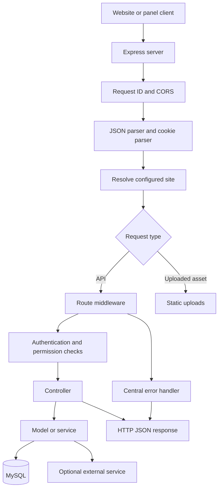

# Punjab Politics Backend

Dedicated REST API for the Punjab Politics website and management panel. The service is built with Express 5 and uses MySQL through `mysql2/promise`. It serves public website data, account and content workflows, administration endpoints, uploaded files, and Swagger UI.

## Contents

- [Architecture and request flow](#architecture-and-request-flow)
- [Run locally](#run-locally)
- [Environment configuration](#environment-configuration)
- [Authentication and authorization](#authentication-and-authorization)
- [Response and error contract](#response-and-error-contract)
- [Database storage and formats](#database-storage-and-formats)
- [Content workflow](#content-workflow)
- [Uploads and static files](#uploads-and-static-files)
- [External integrations and background work](#external-integrations-and-background-work)
- [API endpoint catalog](#api-endpoint-catalog)
- [Seed commands](#seed-commands)
- [Review notes](#review-notes)

## Architecture and request flow



At startup, [`server.js`](server.js) loads environment configuration, verifies the MySQL connection, ensures the base schema and Punjab Politics site record exist, then listens on `PORT` (default `8002`). The startup path also begins scheduled-content publishing. In non-production environments, the database itself is created if it does not exist; production requires the database to be provisioned in advance.

For each request, the server:

1. Assigns a UUID and returns it in the `X-Request-Id` response header.
2. Applies credentialed CORS using configured origins and registered site domains.
3. Parses JSON and cookies.
4. Resolves the configured site from `SITE_SLUG` (default `punjab-politics`) and attaches it to `req.site`. Most data reads and writes are scoped to this site.
5. Serves `/uploads/*` from the backend uploads directory, serves Swagger UI at `/api-docs`, or forwards `/api/*` to a route module.
6. Runs route-specific authentication, authorization, upload, validation, controller, and data-access logic.
7. Serializes the result as JSON. Errors reach the final Express error middleware, which handles malformed JSON, CORS rejection, Multer errors, and normalized server errors.

The application mounts route modules under `/api`; for example, the route `/news/home` is available as `GET /api/news/home`. The implementation is organized into `src/routes`, `src/controllers`, `src/models`, `src/services`, `src/middleware`, `src/config`, and `src/utils`.

## Run locally

Requirements: Node.js, npm, and a MySQL server accessible with the configured database credentials.

```powershell
cd punjabpolitics-backend
Copy-Item .env.example .env
npm install
npm run dev
```

The API defaults to `http://localhost:8002`. The frontend and panel defaults in development are `http://localhost:3002` and `http://localhost:3003`. Update `.env` if your local ports differ. The server verifies its database connection before it starts listening; check the database settings if startup exits early.

Useful URLs:

- `GET /` returns the plain-text readiness message `API is running...`.
- `GET /health` checks the database with `SELECT 1` and returns a health status.
- `/api-docs` opens the Swagger UI generated from route OpenAPI comments. Not every registered route has a detailed OpenAPI annotation; this README's route catalog is the broader route inventory.

## Environment configuration

Use `.env.example` as the variable-name reference. Never commit real credentials or production secrets.

| Variable | Purpose |
| --- | --- |
| `NODE_ENV` | Set to `production` for production behavior and strict required-variable checks. |
| `PORT` | HTTP listen port; defaults to `8002`. |
| `SITE_SLUG` | Site record resolved for requests; defaults to `punjab-politics`. |
| `CLIENT_ORIGIN`, `PANEL_ORIGIN`, `API_PUBLIC_URL` | Browser origins used for CORS and auth links. Multiple comma-separated origins are supported by the relevant configuration. |
| `DB_HOST`, `DB_PORT`, `DB_USER`, `DB_PASSWORD`, `DB_NAME` | MySQL connection settings. `DB_NAME` may contain only letters, numbers, `_`, and `-`. |
| `JWT_SECRET`, `JWT_EXPIRES_IN` | JWT signing secret and optional token lifetime (`7d` by default). Use a long, unique secret outside local development. |
| `COOKIE_SAME_SITE`, `COOKIE_DOMAIN` | Optional auth-cookie behavior. Production cookies are secure; configure cross-site cookie settings consistently with frontend domains and HTTPS. |
| `GOOGLE_CLIENT_ID` | Google Identity Services client ID. Required to use Google sign-in. |
| `EMAIL_HOST`, `EMAIL_PORT`, `EMAIL_USE_TLS`, `EMAIL_HOST_USER`, `EMAIL_HOST_PASSWORD`, `CONTACT_EMAIL` | SMTP settings for verification, password-reset, notification, and contact email flows. |
| `GEMINI_API_KEY`, `GEMINI_MODEL` | AI content analysis configuration. The model defaults in the service if not set. |
| `INDIAN_RAJNITI_SYNDICATION_ENABLED`, `INDIAN_RAJNITI_API_URL`, `INDIAN_RAJNITI_SITE_URL`, `INDIAN_RAJNITI_SITE_DOMAIN`, `INDIAN_RAJNITI_CACHE_SECONDS`, `INDIAN_RAJNITI_TIMEOUT_MS` | Optional syndicated Punjab-related news integration and its cache/request limits. |
| `SWAGGER_SERVER_URL` | Optional server URL displayed by Swagger UI. |

Production startup currently requires `CLIENT_ORIGIN`, `JWT_SECRET`, `DB_HOST`, `DB_USER`, `DB_PASSWORD`, and `DB_NAME`. Provider credentials are needed only for the features that use those providers.

## Authentication and authorization

`POST /api/auth/login` and Google sign-in issue a signed JWT in an HttpOnly cookie named `token`. Browser clients should send credentials/cookies on subsequent requests. Non-browser clients may instead send:

```http
Authorization: Bearer <jwt>
```

`authenticate` verifies the token, reloads the account, rejects inactive accounts, and attaches the current user, role, permissions, and site ID to `req.user`. `optionalAuthenticate` allows public routes to use a valid identity without requiring one. `authorize(...)` checks roles; `authorizePermission(...)` checks permissions, with `ADMIN` allowed through permission checks. An unauthenticated protected request returns `401`; an authenticated request without the required role or permission returns `403`.

Roles defined by the account schema are `USER`, `AUTHOR`, `EDITOR`, `ADMIN`, `SUBADMIN`, and `INVESTOR`. Default permissions are defined in [`src/config/permissions.js`](src/config/permissions.js); route middleware is the authoritative access policy. Some operations are role-only, while others are permission-based. Editors may also be restricted to authors assigned to them for content review.

## Response and error contract

Most JSON handlers return a `success` boolean and then resource-specific fields. There is no universal response envelope: check the particular endpoint for its payload key (`user`, `post`, `posts`, `categories`, and so on). The root route is plain text.

Examples below show the actual response shapes, with representative data:

```http
GET /health
```

```json
{
	"success": true,
	"status": "healthy"
}
```

```http
GET /api/news/categories
```

```json
{
	"success": true,
	"categories": ["Punjab", "Governance", "Politics"]
}
```

Successful password login returns a user object and sets the JWT cookie; it does not return the JWT in the JSON body:

```json
{
	"success": true,
	"message": "Login successful",
	"user": {
		"id": 42,
		"name": "Example User",
		"email": "user@example.com",
		"role": "AUTHOR"
	}
}
```

Creating a content draft returns `201 Created` and a typed `post`:

```json
{
	"success": true,
	"message": "Article draft created",
	"post": {
		"id": 101,
		"title": "Example headline",
		"status": "DRAFT",
		"type": "ARTICLE"
	}
}
```

Validation errors commonly return `400` with `success: false` and a message. Content field validation may also include `code: "VALIDATION_ERROR"` and `fieldErrors`. The centralized error response includes a stable message, a machine-readable `code`, and `requestId`:

```json
{
	"success": false,
	"message": "The server could not complete this request. Please try again.",
	"code": "INTERNAL_ERROR",
	"requestId": "a UUID"
}
```

Not all controller-level errors use the centralized helper, so `code` and `requestId` are not guaranteed in every error body. Common status codes are `400` for invalid input, `401` for missing/invalid authentication, `403` for denied access, `404` for a missing resource, `409` for a conflict, and `500` for an unexpected server error. `GET /health` returns `503` when its database check fails. Upload errors are JSON `400` responses rather than Express HTML error pages.

## Database storage and formats

The API stores application records in MySQL, accessed through the shared connection pool in [`src/config/db.js`](src/config/db.js). SQL statements use parameterized values. The base tables are created/checked during startup by `src/config/baseSchema.js` and `src/config/db.js`; startup also performs some additive schema checks/changes. In development, the configured database is created if missing. In production, provision the database before starting the service.

| Data area | Main tables | Stored data |
| --- | --- | --- |
| Accounts and permissions | `users` | Name/email, password hash or Google subject, role/status, permission JSON, accepted policy IDs, site ID, and uploaded-document paths. Passwords are stored as hashes, not plaintext. |
| Editorial content | `articles`, `blogs`, `videos` | Author/site IDs, text, slug, category, image/video URLs, workflow and AI status, review metadata, publish/schedule times, and view counts. |
| Geography and political reference | `states`, `districts`, `parties`, `politicians` | Slugs and descriptive fields, ordering, site ownership, and selected structured JSON fields (for example politician education/timeline/bio). |
| Site configuration | `sites`, `site_reference_visibility`, `home_widgets`, `ui_sections`, `categories`, and related tables | Site identity/branding, widget configuration, section/reference visibility, categories, and site-specific settings. |
| Applications and careers | `role_applications`, `career_jobs`, `career_applications` | Application/job fields, review state and notes, applicant/user references, and document paths. |
| Comments, policies, and services | `comments`, policy/service tables, and related tables | User comments and visibility, published/admin-managed policy content, and site services. |
| Contributor earnings | `wallets`, `wallet_transactions`, withdrawal/bonus/rate tables | Point balances, transaction history, withdrawal state, reward rates, and optional transaction metadata. Wallet balance and transaction writes use SQL transactions and row locks. |

The exact columns and enum values are defined by the table-creation SQL and individual model queries; the table above summarizes the principal domains rather than listing every column. Important common representations:

- IDs use unsigned integer types (`INT` or `BIGINT`); site ownership is generally represented by `site_id`.
- Roles, workflow states, and transaction categories are stored as enum or string values such as `AUTHOR`, `PENDING`, and `CREDIT`.
- Text uses `VARCHAR`, `TEXT`, or `LONGTEXT`, depending on the field. Timestamps use MySQL `TIMESTAMP`, `DATETIME`, or `DATE` columns.
- Flags use numeric boolean columns such as `TINYINT(1)`. Counts, points, sort order, and view totals use integer columns; rates and currency-related settings use numeric columns.
- Structured fields use MySQL `JSON` where defined, including tags, permissions, accepted policy IDs, and some reference-data fields. Models serialize JavaScript values with `JSON.stringify` on writes and parse JSON fields when reading rows. Other flexible metadata is also JSON-serialized before being stored.
- Media/documents are not stored as binary data in the database. The file is saved under `uploads/`; the database stores its relative URL/path, such as `/uploads/article/<generated-name>-optimized.webp`.
- Several content/reference records support soft deletion using fields such as `deleted_at`, `deleted_by`, and `delete_reason`; deletion behavior depends on the owning endpoint/model.

## Content workflow

Articles, blogs, and videos share the same contributor and editorial lifecycle:

1. An authorized contributor creates a draft through `POST /api/articles`, `/api/blogs`, or `/api/videos`.
2. The contributor may edit the draft and inspect its status. Content is scoped to the current site and its owner.
3. `POST /api/{articles|blogs|videos}/:id/submit` submits eligible content for review and runs the configured AI check where applicable.
4. Editors with review permission load the history/review queue and review content. Editor assignments may limit which authors an editor can review.
5. Review actions approve, reject, or request updates. Approved content can be published immediately or scheduled, depending on the review request.
6. The scheduled publisher runs once at startup and then every 30 seconds. Public news endpoints read published content, not contributor drafts.

Content states include `DRAFT`, `PENDING`, `APPROVED`, and `REJECTED`. AI status and review metadata are tracked separately. Editing content resets it to a draft according to the controller workflow. Point/wallet behavior is available through the wallet endpoints.

## Uploads and static files

Content upload routes use `multipart/form-data`. Article/blog images use `featuredImage` and optional `additionalImages` (up to 10). Videos use `thumbnail` and may use `videoFile` when the selected source is an upload. Supported image types are JPEG, PNG, WebP, GIF, and AVIF; uploaded images are rotated, resized to fit within 1920 x 1920 without enlargement, and converted to WebP. Supported uploaded video types are MP4, WebM, Ogg, and QuickTime. Content files are limited to 200 MB each.

KYC, resume, and career application documents have separate upload handlers, accept supported images, PDF, or Word documents, and are limited to 20 MB each. Stored content assets are served under `/uploads/...`; these static responses use long-lived immutable caching headers. In production, provision durable storage and backups for the uploads directory and keep it separate from other applications' uploads.

## External integrations and background work

- **Google Identity Services:** validates Google credentials for login/registration.
- **SMTP:** sends registration OTPs, password reset messages, account notifications, and contact messages.
- **Gemini:** performs AI analysis for submitted editorial content when configured.
- **Indian Rajniti news:** can supply cached Punjab-related syndicated news to the public homepage. Its feature can be disabled with `INDIAN_RAJNITI_SYNDICATION_ENABLED=false`.
- **Scheduled publishing:** a process-local timer publishes due scheduled articles/blogs every 30 seconds. If multiple backend instances run concurrently, review this job's deployment/coordination behavior.

## API endpoint catalog

All paths below are prefixed with `/api`. `Public` means no route-level authentication middleware; `Auth` means a signed-in account is required; `Role/permission` identifies the route's additional guard. Route authorization remains enforced by the server regardless of this documentation.

### Health and site

| Method and path | Access | Purpose |
| --- | --- | --- |
| `GET /` | Public | Plain-text server readiness response (not under `/api`). |
| `GET /health` | Public | MySQL health check (not under `/api`). |
| `GET /sites/current` | Public | Current resolved site. |
| `GET /admin/sites` | Auth + site-management permission | List manageable sites. |
| `GET /admin/site-features` | Auth | Current site's feature configuration. |
| `POST /admin/sites` | Auth + `ADMIN` | Create a site, including uploaded images. |
| `PATCH /admin/sites/:id` | Auth + website-management permission | Update site details and images. |

### Authentication and users

| Method and path | Access | Purpose |
| --- | --- | --- |
| `POST /auth/register/request-otp` | Public | Request email verification code. |
| `POST /auth/register/verify-otp` | Public | Verify code and receive a registration verification token. |
| `POST /auth/register` | Public | Create a verified account. |
| `GET /auth/google/config` | Public | Read public Google sign-in configuration. |
| `POST /auth/google` | Public | Google login or registration. |
| `POST /auth/login` | Public | Password login; sets HttpOnly auth cookie. |
| `GET /auth/me` | Auth | Get the current user. |
| `POST /auth/logout` | Auth | Clear the auth cookie. |
| `POST /auth/forgot-password` | Public | Request password-reset email. |
| `POST /auth/reset-password` | Public | Reset password with a valid token. |
| `POST /auth/change-password` | Auth | Change current user's password. |
| `GET /auth/users` | Auth + team/user permission or allowed role | List users. |
| `POST /auth/admin/users` | Auth + team-members permission | Assign a contributor role to an existing account; accepts multipart KYC documents. |
| `PATCH /auth/users/:id` | Auth + team-members permission | Update user details/role. |
| `PATCH /auth/users/:id/role` | Auth + team-members permission | Update user role. |
| `PATCH /auth/users/:id/editor` | Auth + `ADMIN` or `SUBADMIN` | Assign/unassign editor review responsibility. |
| `DELETE /auth/users/:id` | Auth + team/user permission | Delete a user. |

### Public news and reference data

| Method and path | Access | Purpose |
| --- | --- | --- |
| `GET /news/home` | Public | Homepage sections, published posts, and managed widgets. |
| `GET /news/categories` | Public | Visible categories. |
| `GET /news/topics?term=...` | Public | Published articles/blogs matching one or more repeated topic terms. |
| `GET /news/posts/:slug` | Public | Published article/blog by slug. |
| `GET /politicians` | Public | Politicians grouped by category. |
| `GET /politicians/:slug` | Public | Politician details. |
| `GET /parties` | Public | Parties list. |
| `GET /parties/:slug` | Public | Party details. |
| `GET /states` | Public | States and union territories. |
| `GET /states/:slug` | Public | State details. |
| `GET /districts` | Public | District list. |
| `GET /districts/:slug` | Public | District details. |
| `GET /parliament` | Public | Parliament data. |
| `GET /vidhan-sabhas` | Public | Assembly data. |
| `GET /page-profiles` | Public | Page profile data. |
| `POST /poll/vote` | Public | Submit a poll vote. |

### Contributor content and moderation

The following route set is registered separately for each resource: `articles`, `blogs`, and `videos`.

| Method and path | Access | Purpose |
| --- | --- | --- |
| `POST /:resource` | Auth + create permission | Create a draft; multipart upload fields depend on resource. |
| `GET /:resource` | Auth + own-content permission | List the current contributor's content; optional `status` filter. |
| `GET /:resource/history` | Auth + history/review permission or `INVESTOR` | List site content across authors. |
| `GET /:resource/:id` | Auth + own-content/review/history permission | Read content details. |
| `PUT /:resource/:id` | Auth + own-content permission | Update content. |
| `DELETE /:resource/:id` | Auth + own-content/review permission | Delete content. |
| `POST /:resource/:id/submit` | Auth + own-content permission | Submit draft for AI/editorial review. |
| `GET /:resource/:id/status` | Auth + own-content/review permission | Read workflow status. |
| `POST /:resource/:id/review` | Auth + review permission | Approve, reject, or request changes. |
| `PATCH /:resource/:id/comments` | Auth + comment-management permission | Enable/disable comments for a post. |
| `POST /content/bulk` | Auth + review permission | Bulk approve, reject, or delete content. |

Replace `:resource` with `articles`, `blogs`, or `videos`. Additional content routes and upload field details are documented in [`src/routes/content.routes.js`](src/routes/content.routes.js).

### Applications and careers

| Method and path | Access | Purpose |
| --- | --- | --- |
| `POST /applications` | Auth in the registered route | Submit an Author/Editor/Investor application with multipart documents. Note: the route comment calls this public, but the route currently includes `authenticate`. |
| `GET /applications` | Auth + `ADMIN` | List role applications. |
| `POST /applications/:id/review` | Auth + `ADMIN` | Approve or reject a role application. |
| `GET /careers` | Public | List public job postings. |
| `GET /careers/:slug` | Public | Read a job posting. |
| `GET /careers/manage` | Auth + career-management permission | List/manage all job postings. |
| `POST /careers` | Auth + career-management permission | Create a job posting. |
| `PATCH /careers/:id` | Auth + career-management permission | Update a posting. |
| `PATCH /careers/:id/status` | Auth + career-management permission | Open/close a posting. |
| `DELETE /careers/:id` | Auth + career-management permission | Delete a posting. |
| `POST /careers/:id/apply` | Auth + member role | Submit an application with resume/documents. |
| `GET /careers/:id/my-application` | Auth + member role | Read the current user's application. |
| `GET /careers/:id/applications` | Auth + career-management permission | List applications for a job. |
| `POST /careers/:id/applications/:appId/review` | Auth + career-management permission | Review a job application. |

### Categories, policies, comments, and services

| Method and path | Access | Purpose |
| --- | --- | --- |
| `GET /categories` | Public | List categories. |
| `POST /categories` | Auth + category-management permission | Create a category. |
| `GET /categories/:id/content` | Public | Read category content. |
| `PATCH /categories/:id/content` | Auth + category-management permission | Update category content. |
| `PATCH /categories/:id/visibility` | Auth + category-management permission | Toggle category visibility. |
| `DELETE /categories/:id` | Auth + category-management permission | Delete a category. |
| `GET /admin/ui-visibility` | Auth + category-management permission | Read UI section visibility. |
| `GET /admin/reference-visibility` | Auth + category-management permission | Read reference visibility. |
| `PATCH /admin/reference-visibility/:type/:id` | Auth + category-management permission | Update reference visibility. |
| `PATCH /admin/ui-sections/:key/visibility` | Auth + role/permission | Update section visibility. |
| `GET /policies` | Public | List published policies. |
| `GET /policies/registration` | Public | List registration policies. |
| `GET /policies/:slug` | Public | Read a published policy. |
| `GET /policies/manage` | Auth + policy-management permission | List policies for administration. |
| `POST /policies` | Auth + policy-management permission | Create a policy. |
| `PATCH /policies/:id` | Auth + policy-management permission | Update a policy. |
| `DELETE /policies/:id` | Auth + policy-management permission | Delete a policy. |
| `GET /comments/post/:slug` | Public, optional authentication | List visible comments for a post. |
| `POST /comments` | Auth | Add a comment. |
| `DELETE /comments/:id` | Auth | Delete a comment subject to ownership/authorization checks. |
| `GET /admin/comments` | Auth + comment-management permission | List comments for moderation. |
| `PATCH /admin/comments/:id/visibility` | Auth + comment-management permission | Hide/show a comment. |
| `POST /contact` | Public | Submit a contact message. |
| `GET /services` | Public | List visible services when enabled for the site. |
| `GET /services/:slug` | Public | Read a visible service. |
| `GET /admin/services` | Auth + service-management permission | List services for management. |
| `POST /admin/services` | Auth + service-management permission | Create a service. |
| `PATCH /admin/services/:id` | Auth + service-management permission | Update a service. |
| `DELETE /admin/services/:id` | Auth + service-management permission | Delete a service. |

### Site/reference administration

| Method and path | Access | Purpose |
| --- | --- | --- |
| `GET /admin/site-management` | Auth + site-management permission | Read site settings. |
| `PUT /admin/site-management/header` | Auth + site-management permission | Update site header settings. |
| `GET /admin/reference-data` | Auth + site-data permission | Read managed reference data. |
| `POST /admin/reference-data/{politicians|parties|states|districts}` | Auth + matching site permission | Create a reference record. |
| `PATCH /admin/reference-data/{politicians|parties|states|districts}/:id` | Auth + matching site permission | Update a reference record. |
| `DELETE /admin/reference-data/{politicians|parties|states|districts}/:id` | Auth + matching site permission | Soft-delete a reference record. |
| `PUT /admin/reference-data/parliament` | Auth + parliament permission | Update parliament data. |
| `PUT /admin/reference-data/schedule/:type` | Auth + schedules permission | Update a schedule. |
| `PUT /admin/reference-data/vidhan-sabhas` | Auth + assembly permission | Update assembly data. |
| `PUT /admin/reference-data/home-widgets/:key` | Auth + widget authorization | Update a home widget. |
| `PUT /admin/reference-data/page-profiles` | Auth + page-profile permission | Update page profiles. |

### Wallet, limits, and deleted items

| Method and path | Access | Purpose |
| --- | --- | --- |
| `GET /wallet` | Auth + `AUTHOR` or `EDITOR` | Read wallet and recent transactions. |
| `POST /wallet/withdrawals` | Auth + `AUTHOR` or `EDITOR` | Request a withdrawal with a UPI ID (`points`, `upiId`). Emails the Contact mailbox. |
| `PATCH /wallet/bonuses/:bonusId/acknowledge` | Auth + `AUTHOR` or `EDITOR` | Acknowledge a bonus. |
| `GET /admin/withdrawals` | Auth + wallet-management permission | List withdrawal requests (`?status=PENDING\|PAID\|REJECTED`). |
| `PATCH /admin/withdrawals/:withdrawalId/pay` | Auth + wallet-management permission | Mark a request paid with the bank `utrNumber`; emails the contributor. |
| `PATCH /admin/withdrawals/:withdrawalId/reject` | Auth + wallet-management permission | Reject with a `reason`; points are returned and the contributor is emailed. |
| `GET /admin/wallets` | Auth + wallet-management permission | List wallets and withdrawals. |
| `GET /admin/wallets/withdrawal-settings` | Auth + `ADMIN` | Read withdrawal settings. |
| `PUT /admin/wallets/withdrawal-settings` | Auth + `ADMIN` | Update withdrawal settings. |
| `PATCH /admin/wallets/:userId/withdrawal-access` | Auth + wallet-management permission | Enable/disable withdrawals for a user. |
| `GET /admin/wallets/point-rates` | Auth + point-rate permission | Read point/reward rates. |
| `PUT /admin/wallets/point-rates` | Auth + point-rate permission | Update point/reward rates. |
| `POST /admin/wallets/bonuses` | Auth + `ADMIN` | Award a content bonus. |
| `GET /content-limits/me` | Auth | Read current user's posting limits. |
| `GET /admin/content-limits` | Auth + posting-limit permission | Read posting limits. |
| `PUT /admin/content-limits` | Auth + posting-limit permission | Update posting limits. |
| `GET /admin/deletions` | Auth + deleted-item permission | List soft-deleted records. |
| `PATCH /admin/deletions/:id/restore` | Auth + deleted-item permission | Restore a soft-deleted record. |
| `DELETE /admin/deletions/:id/permanent` | Auth + deleted-item permission | Permanently delete a record. |

## Seed commands

| Command | Purpose |
| --- | --- |
| `npm run seed:database` | Runs widget, reference, geography, politician, and category seed scripts in sequence. |
| `npm run seed:widgets` | Runs `scripts/seedNews.js`. |
| `npm run seed:reference` | Seeds reference data. |
| `npm run seed:geography` | Seeds geography data. |
| `npm run seed:politicians` | Seeds politician data. |
| `npm run seed:categories` | Seeds categories. |
| `npm run seed:content` | Seeds content data. |

Review a seed script before running it against a database containing data you need to preserve.

## Review notes

- The API is intentionally isolated from the Indian Rajniti backend. Use a separate Punjab Politics database and uploads storage; do not point this project at the Indian Rajniti production database.
- Database setup/schema assurance currently runs from application startup in `src/config/db.js`; production startup should be reviewed with the deployment's schema/change-management expectations in mind.
- `POST /api/applications` currently requires authentication because its registered route includes `authenticate`, despite a nearby route comment describing a public application flow.
- The homepage may include syndicated content when the integration is enabled; inspect the integration settings and its fallback behavior when reviewing public feed output.
- The scheduled publishing timer is process-local. Multiple instances need operational consideration to prevent duplicate work or inconsistent scheduling.
- For endpoint-specific request schemas, status codes, and examples, use Swagger at `/api-docs` and the corresponding route/controller implementation. This README is an architectural overview and route index, not a replacement for source-level review.
